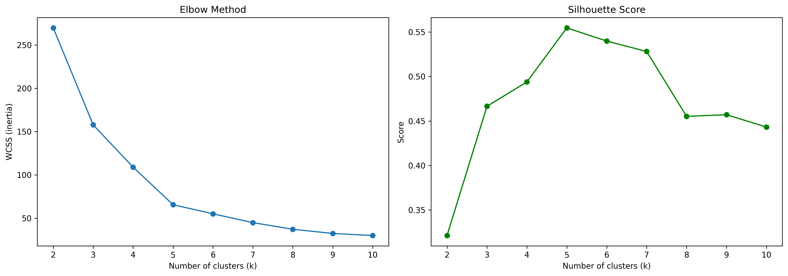
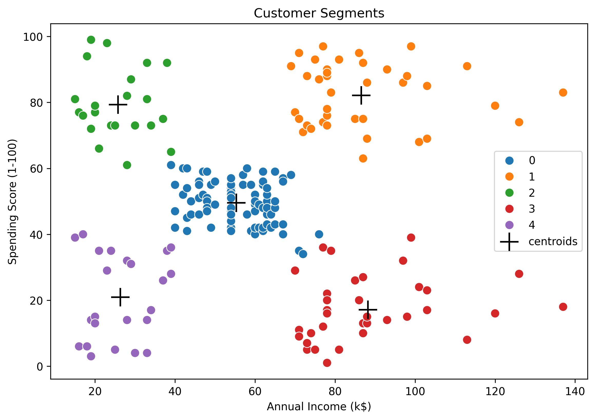
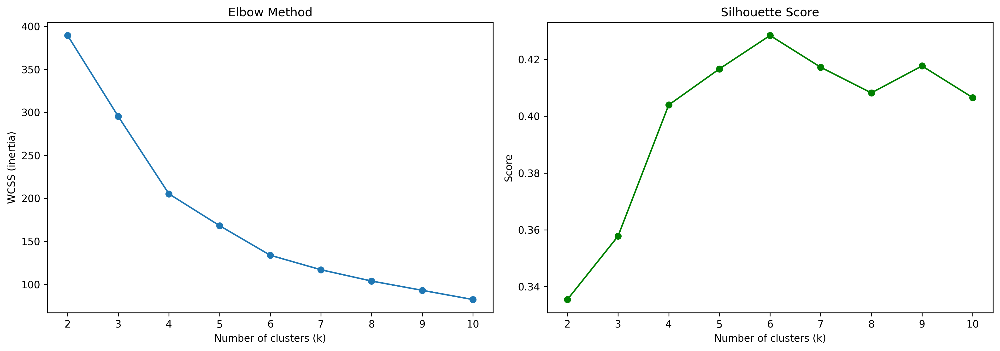
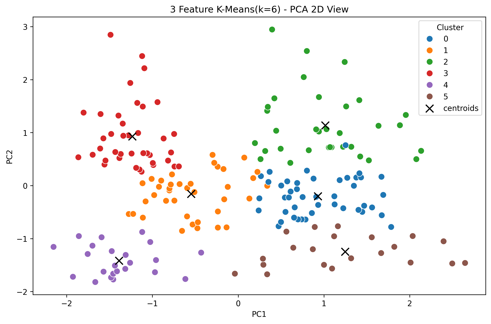
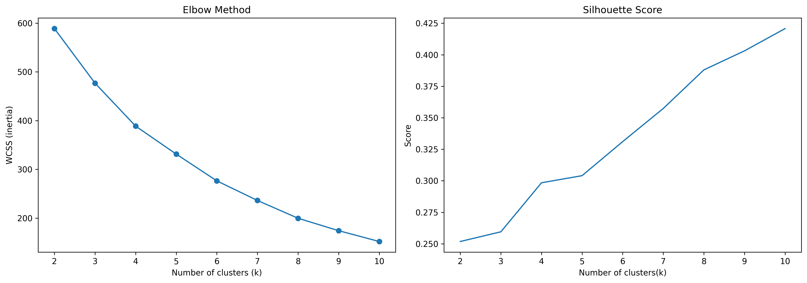
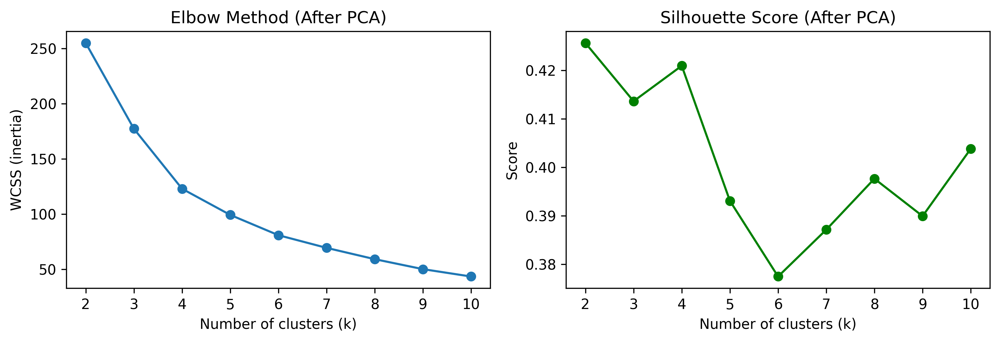
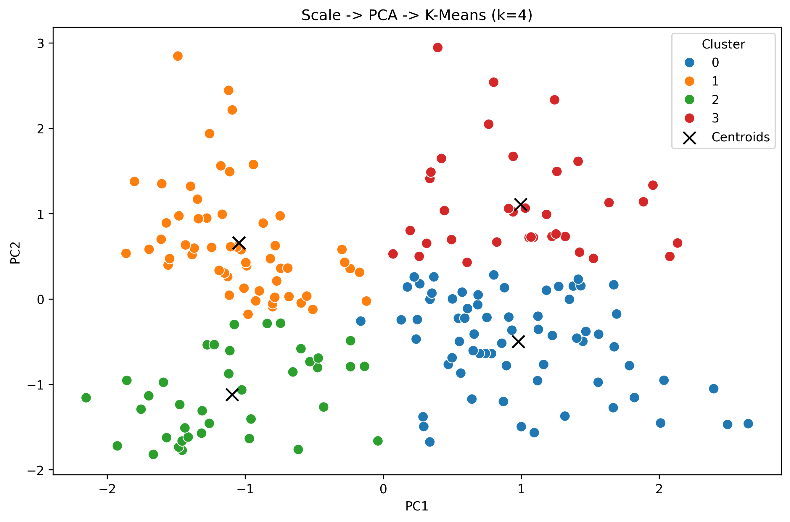

# Mall Customer Segmentation with K-Means

This project groups mall customers into segments using K-Means clustering. Along the way I compared a few different ways of setting it up, with and without PCA and with different sets of features, to see which one gives the most useful segments.

The short version: using just **Annual Income** and **Spending Score** with **k = 5** gave the cleanest and most interpretable result. The rest of the notebook explains why the other options didn't beat it.

## Dataset

The Mall Customers dataset (available on Kaggle) has 200 customers and 5 columns:

| Column | Description |
|---|---|
| CustomerID | Unique ID (not used for clustering) |
| Gender | Male / Female (encoded as 0 = Female, 1 = Male) |
| Age | Age in years |
| Annual Income (k$) | Annual income in thousands of dollars |
| Spending Score (1-100) | Score assigned by the mall based on spending behaviour |

There are no missing values and no duplicate rows.

## What I tried

I ran four experiments. Each one scales the features first, since K-Means is distance based, and picks k using the elbow method (WCSS) together with the silhouette score.

### 1. Income + Spending Score

Two features, so the clusters can be plotted directly with no PCA. This is the cleanest case: WCSS drops steeply until k = 5 and then flattens, and the silhouette score peaks at k = 5 (0.5547).





*Cluster numbers in this plot: 0 = standard, 1 = target customers, 2 = young trend-driven spenders, 3 = untapped potential, 4 = budget-conscious.*

### 2. Age + Income + Spending Score

Here PCA is used only to draw the clusters in 2D, not to create them. The elbow plot has no sharp bend (WCSS falls steeply until k = 4 and then flattens gradually), and the silhouette peaks at k = 6 (0.4284), only slightly above k = 5. I went with k = 6 because it has the highest silhouette and it splits the large middle group into an older and a younger half.





### 3. All four features, including Gender

This one is a diagnostic. There is no clear elbow, and the silhouette keeps rising all the way to k = 10. A crosstab showed why: at k = 10, nine of the ten clusters contain only one gender. Gender is a 0/1 column, and after scaling it creates a bigger gap than any of the other features, so K-Means splits on it first. I stopped here and left Gender out of the clustering from then on.



### 4. Age + Income + Spending Score, then PCA (2 components), then K-Means

This keeps about 77.6% of the variance and clusters in the reduced space. k = 2 has a slightly higher silhouette (0.4256), but I chose k = 4 (0.4209) because the WCSS is still falling steeply at 2, k = 4 sits near the bend in the elbow curve, and it gives four distinguishable segments.





## Results

| Approach | k | Silhouette |
|---|---|---|
| Income + Spending | 5 | 0.5547 |
| Age + Income + Spending | 6 | 0.4284 |
| All 4 features (with Gender) | no meaningful k | 0.42 at k = 10 (gender split) |
| Age + Income + Spending, then PCA(2) | 4 | 0.4209 |

I also compared the segmentations using the adjusted Rand index (ARI), taking the 2-feature result as the reference:

- 3 features vs 2 features: **0.70**. Very similar. The four outer segments are almost identical, and the only real difference is that the large middle group splits into an older and a younger half.
- PCA version vs 2 features: **0.46**. PCA breaks up the middle group and absorbs the low income / low spending customers into a mostly average cluster. Part of this gap is simply because k is different (4 vs 5).

One caveat: silhouette scores computed in different feature spaces are not strictly comparable, so I treated them as a rough guide and also looked at whether the segments made sense.

## The five segments (2 features, k = 5)

| Segment | Customers | Avg age | Avg income (k$) | Avg spending |
|---|---|---|---|---|
| Target customers (high income, high spending) | 39 | 32.7 | 86.5 | 82.1 |
| Untapped potential (high income, low spending) | 35 | 41.1 | 88.2 | 17.1 |
| Young trend-driven spenders (low income, high spending) | 22 | 25.3 | 25.7 | 79.4 |
| Budget-conscious (low income, low spending) | 23 | 45.2 | 26.3 | 20.9 |
| Standard customers (average on everything) | 81 | 42.7 | 55.3 | 49.5 |

A few observations:

- The biggest group, about 40% of customers, is the average segment.
- The high income, low spending group looks like the clearest opportunity, since these customers could probably spend more with the right offers.
- The gender mix is similar in every segment (roughly 56% female overall), so Gender doesn't help tell the segments apart. That is a good reason to leave it out of the clustering.

## Takeaways

- More features doesn't mean better clusters. Adding Age made the segments less sharp, and adding Gender broke the clustering.
- PCA doesn't help much when you only have two or three features. It is more useful as a visualisation tool here.
- The elbow method alone was not always decisive (for the 3-feature model there is no sharp bend), so combining it with silhouette scores and checking the cluster profiles was important.

## How to run

1. Clone this repository.
2. Install the dependencies:
   ```
   pip install numpy pandas matplotlib seaborn scikit-learn jupyter
   ```
3. Put `Mall_Customers.csv` in the same folder as the notebook.
4. Open `mall_customer_segmentation.ipynb` and run all cells.

I built this on Python 3.14. Other recent Python 3 versions should work too, but I haven't tested them. Everything uses `random_state=42`, so cluster numbers (0, 1, 2, ...) should match the ones described here. With a different seed the groups will be the same but the labels may be shuffled.

## Project structure

```
.
├── mall_customer_segmentation.ipynb
├── Mall_Customers.csv
├── images/
│   ├── Method1.png
│   ├── method1_cluster.png
│   ├── method2.png
│   ├── method2_clusters.png
│   ├── method3.png
│   ├── method4.png
│   └── method4_clusters.png
└── README.md
```

## Limitations and ideas for later

The dataset is small (200 rows), so these segments are a good starting point rather than a final answer. Things I'd like to try next:

- Hierarchical clustering or DBSCAN, to see whether they find the same groups
- K-Prototypes, which handles categorical features like Gender properly
- Checking how stable the clusters are across different random seeds
